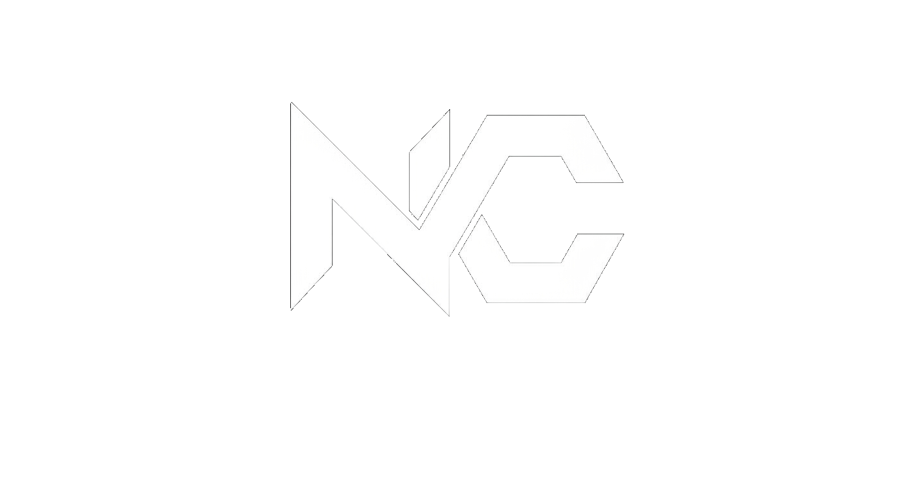

<!-- Improved compatibility of back to top link: See: https://github.com/othneildrew/Best-README-Template/pull/73 -->
<a id="readme-top"></a>

<!-- PROJECT SHIELDS -->
[![Contributors][contributors-shield]][contributors-url]
[![Forks][forks-shield]][forks-url]
[![Stargazers][stars-shield]][stars-url]
[![Issues][issues-shield]][issues-url]
[![MIT License][license-shield]][license-url]


<!-- PROJECT HEADER -->
<br />
<div align="center">
  <a href="https://muhammadessa2002.github.io/neural_canvas/">
    
  </a>
  <h3 align="center">Neural Canvas: MNIST Neural Network Visualizer</h3>

  <p align="center">
    An interactive, browser-based visualization of neural networks recognizing handwritten digits.
    <br />
    <a href="https://github.com/MuhammadEssa2002/neural_canvas"><strong>Explore the docs »</strong></a>
    <br />
    <br />
    <a href="https://muhammadessa2002.github.io/neural_canvas/">View Demo</a>
    &middot;
    <a href="https://github.com/MuhammadEssa2002/neural_canvas/issues/new?labels=bug">Report Bug</a>
    &middot;
    <a href="https://github.com/MuhammadEssa2002/neural_canvas/issues/new?labels=enhancement">Request Feature</a>
  </p>
</div>


<!-- TABLE OF CONTENTS -->
<details>
  <summary>Table of Contents</summary>
  <ol>
    <li>
      <a href="#about-the-project">About The Project</a>
      <ul>
        <li><a href="#features">Features</a></li>
        <li><a href="#models">Models</a></li>
        <li><a href="#accuracy-and-limitations">Accuracy and Limitations</a></li>
        <li><a href="#how-it-works">How It Works</a></li>
        <li><a href="#built-with">Built With</a></li>
      </ul>
    </li>
    <li>
      <a href="#getting-started">Getting Started</a>
      <ul>
        <li><a href="#prerequisites">Prerequisites</a></li>
        <li><a href="#installation">Installation</a></li>
      </ul>
    </li>
    <li>
      <a href="#usage">Usage</a>
      <ul>
        <li><a href="#controls">Controls</a></li>
        <li><a href="#project-structure">Project Structure</a></li>
        <li><a href="#model-weight-format">Model Weight Format</a></li>
      </ul>
    </li>
    <li><a href="#roadmap">Roadmap</a></li>
    <li><a href="#contributing">Contributing</a></li>
    <li><a href="#license">License</a></li>
    <li><a href="#contact">Contact</a></li>
    <li><a href="#acknowledgments">Acknowledgments</a></li>
  </ol>
</details>


<!-- ABOUT THE PROJECT -->
## About The Project

[![Neural Canvas Screen Shot][product-screenshot-1]](https://muhammadessa2002.github.io/neural_canvas/)

[![Neural Canvas Screen Shot][product-screenshot-2]](https://muhammadessa2002.github.io/neural_canvas/)

Draw a digit on the 28×28 board and watch the activations flow through every layer in real time, from the input pixels, through the hidden layers, to the final prediction.

Everything runs client-side using [p5.js](https://p5js.org/) for rendering and [Math.js](https://mathjs.org/) for the matrix math. The networks were trained in Python (NumPy and JAX), and their weights are loaded from JSON files, so the forward pass you see on screen is computed live in the browser.

**Live demo:** https://muhammadessa2002.github.io/neural_canvas/

### Features

* Draw digits on a 28×28 canvas with a soft, anti-aliased brush (MNIST-style input)
* Live forward pass: every neuron's activation is displayed and color-coded
* Connections light up according to the input pixels and layer activations
* Six pre-trained models you can switch between instantly, including one for Eastern Arabic-Indic digits (٠ ١ ٢ ٣ ٤ ٥ ٦ ٧ ٨ ٩), one for Persian (Farsi) digits (۰ ۱ ۲ ۳ ۴ ۵ ۶ ۷ ۸ ۹), a Siamese network that compares two drawn digits, and a convolutional neural network (CNN) that shows its feature maps
* Siamese mode with two drawing boards: both inputs pass through the same shared weights, and the Euclidean distance between their 32-dimensional embeddings is shown live
* CNN mode: see the output of all eight 3×3 convolution filters for the digit you draw, before ReLU, after ReLU and after 2×2 max pooling, followed by the dense layers and the prediction
* Toggleable neuron shadows and network connection lines
* Multiple selectable backgrounds
* Responsive canvas that scales to the window while preserving the layout
* Mouse and touch support
* Animated loading screen while the models, fonts and images are being loaded

<p align="right">(<a href="#readme-top">back to top</a>)</p>


### Models

Models 1 to 5 are fully connected networks using ReLU activations in the hidden layers, and Model 6 is a convolutional neural network (CNN) with a fully connected head. Models 1 to 3 were trained with plain gradient descent for 2,000 epochs, Model 4 with mini-batch gradient descent with momentum for 200 epochs, Model 5 (a Siamese network) with mini-batch Adam for 80 epochs, and Model 6 (the CNN) with mini-batch Adam for 30 epochs.

| | Model 1 | Model 2 | Model 3 | Model 4 | Model 5 | Model 6 |
|---|---|---|---|---|---|---|
| Digit set | Western Arabic numerals (0-9) | Western Arabic numerals (0-9) | Eastern Arabic-Indic numerals (٠-٩) | Persian (Farsi) numerals (۰-۹) | Pairs of drawn digits (compared, not classified) | Western Arabic numerals (0-9) |
| Architecture | 784 → 20 → 20 → 10 | 784 → 40 → 40 → 10 | 784 → 20 → 20 → 15 → 10 | 784 → 20 → 20 → 15 → 10 | 784 → 40 → 40 → 40 → 32 | Conv 3×3×8 → MaxPool 2×2 → 1,352 → 40 → 40 → 10 |
| Hidden layers | 2 | 2 | 3 | 3 | 3 | 1 convolutional + 2 dense |
| Parameters | 16,330 | 33,450 | 16,595 | 16,595 | 35,992 | 56,250 |
| Output | Raw scores | Softmax probabilities | Softmax probabilities | Softmax probabilities | 32-D embedding (no softmax) | Softmax probabilities |
| Loss function | Mean Squared Error | Cross-Entropy | Cross-Entropy | Cross-Entropy | Contrastive Loss | Cross-Entropy |
| Optimizer | Vanilla Gradient Descent | Vanilla Gradient Descent | Vanilla Gradient Descent | Mini-batch Gradient Descent with Momentum | Mini-batch Adam | Mini-batch Adam |
| Epochs | 2,000 | 2,000 | 2,000 | 200 | 80 | 30 |
| Test accuracy | 92% | 96% | 96% | 96% | 95% | 98% |
| Training | NumPy (Python) | NumPy (Python) | JAX (Python) | JAX (Python) | JAX (Python) | JAX (Python) |

For Models 1 to 4, the predicted digit is the output neuron with the highest value. In the visualization, Model 2 draws its hidden layers as two columns of neurons to represent the wider layers, and Model 3 shows the additional third hidden layer and renders its prediction in Eastern Arabic-Indic script using the Noto Naskh Arabic font. Model 4 uses the same layer layout as Model 3 but renders its prediction in Persian (Farsi) script using the Parastoo font, which matters because the Persian glyphs for 4, 5 and 6 differ from the Arabic-Indic ones.

Model 5 works differently. It is a Siamese network: it has no digit prediction. Instead, the same network (shared weights) maps each of two drawn digits to a 32-dimensional embedding, and the Euclidean distance between the two embeddings measures how different the drawings are. A small distance means the network considers the two drawings similar, and a large distance means it considers them different. The visualization shows two drawing boards, one network column per input, the two embeddings on the right, and a colored distance bar that goes from green (similar) through blue to red (different). Training used contrastive loss, which pulls embeddings of matching pairs together and pushes non-matching pairs apart. Because 40 neurons per hidden layer would not fit on screen, each hidden layer shows a subset of its neurons, with dots standing in for the hidden ones.

Model 6 is a convolutional neural network. The 28×28 drawing is convolved with eight 3×3 filters (stride 1, no padding), producing eight 26×26 feature maps. These pass through ReLU and are then reduced to 13×13 by 2×2 max pooling. The 1,352 pooled values (13 × 13 × 8) are flattened and fed to two fully connected layers of 40 neurons each, followed by a 10-neuron softmax output, and the prediction is the output neuron with the highest probability. The visualization shows all eight filters as small heat maps in three stages: the convolution output before ReLU (mid-gray is zero, brighter is positive, darker is negative), the same map after ReLU, and the pooled map. Each map is scaled by its own maximum, so brightness can be compared within a map but not across filters. The two dense layers show a subset of their neurons (12 of 40), with dots standing in for the rest.

<p align="right">(<a href="#readme-top">back to top</a>)</p>


### Accuracy and Limitations

Models 1, 2 and 6 were trained on the MNIST handwritten digit dataset, Model 3 was trained on a handwritten Eastern Arabic-Indic digit dataset, and Model 4 was trained on a handwritten Persian (Farsi) digit dataset, all in the same 28×28 format. Model 5 uses the same 28×28 input format and was trained on pairs of digit images. The test accuracies reported above (roughly 92% to 98%) were measured on held-out test data from those datasets.

Real-time drawing on the board can behave differently from those test results. Digits drawn with a mouse or finger are often thicker, thinner, smaller, larger or more off-center than the images the models were trained on, and the brush has its own look compared to scanned handwriting. Because of this, the models may produce unexpected predictions or fluctuating values while you draw, and they will often be less accurate in the browser than their test accuracy suggests. This project is meant as a visual way to understand how a network works, not as a production-grade digit recognizer.

For best results, draw the digit large, centered and with a single clear stroke, similar to MNIST samples. With Model 5, the distance between two drawings of the same digit can still be noticeably above zero, and it grows if the two drawings differ a lot in size, thickness or position. Model 6 has the highest test accuracy of the six, but the same gap between test data and hand-drawn input applies to it.

<p align="right">(<a href="#readme-top">back to top</a>)</p>


### How It Works

1. **Input.** The 28×28 board is stored as a Math.js matrix with values in `[0, 1]` and flattened into a 784×1 vector.
2. **Forward pass.** Each frame computes `Z = W·A + b` for every layer, applying ReLU in the hidden layers. Models 2, 3, 4 and 6 additionally apply softmax to the output layer. Model 6 first applies a 3×3 convolution with eight filters, then ReLU and 2×2 max pooling, flattens the result into a 1,352-value vector, and continues through two dense layers. Model 5 runs the forward pass twice, once for each board, and its final layer is a linear 32-dimensional embedding with no activation.
3. **Rendering.** Neurons are drawn as rounded rectangles whose fill intensity reflects their activation, with the numeric value printed inside. Connection opacity is driven by input pixel intensity and layer outputs. Everything is drawn in a fixed 1600×900 design space that is scaled to fit the window. For Model 6, the feature maps of each filter are drawn as small grayscale grids between the board and the dense layers.
4. **Prediction.** The index of the largest output value is shown in the prediction box (as an Eastern Arabic-Indic digit for Model 3 and a Persian digit for Model 4). Model 5 instead computes the Euclidean distance between the two embeddings and displays it as a number and a color-coded bar.

<p align="right">(<a href="#readme-top">back to top</a>)</p>


### Built With

* [![JavaScript][JavaScript]][JavaScript-url]
* [![p5.js][p5.js]][p5-url]
* [![Math.js][Math.js]][Mathjs-url]
* [![Python][Python]][Python-url]
* [![NumPy][NumPy]][NumPy-url]
* [![JAX][JAX]][JAX-url]

<p align="right">(<a href="#readme-top">back to top</a>)</p>


<!-- GETTING STARTED -->
## Getting Started

To get a local copy up and running, follow these simple steps.

### Prerequisites

A modern web browser and a local web server. A server is required because the sketch loads the model weights, fonts and images through p5.js `preload()`, which browsers block when opening `index.html` directly from the file system.

p5.js and Math.js are loaded from the jsDelivr CDN, so an internet connection is needed on first load.

* Python (for `http.server`) or Node.js (for `npx serve`), either one will do

### Installation

1. Clone the repo
   ```sh
   git clone https://github.com/MuhammadEssa2002/neural_canvas.git
   ```
2. Move into the project folder
   ```sh
   cd neural_canvas
   ```
3. Start any static server, for example:
   ```sh
   python -m http.server 8000
   ```
   or
   ```sh
   npx serve
   ```
4. Open `http://localhost:8000` in your browser

<p align="right">(<a href="#readme-top">back to top</a>)</p>


<!-- USAGE EXAMPLES -->
## Usage

Draw by clicking and dragging inside the board on the left. The network on the right updates live as you draw. In Model 5 (press `5`), two boards appear, one above the other. Draw a digit on each and watch the distance between their embeddings update. In Model 6 (press `6`), the feature maps of all eight convolution filters update as you draw.

_Try the [live demo](https://muhammadessa2002.github.io/neural_canvas/) to see it in action._

### Controls

| Key | Action |
|-----|--------|
| `c` | Clear the board (or both boards in Model 5) |
| `1` | Switch to Model 1 |
| `2` | Switch to Model 2 |
| `3` | Switch to Model 3 |
| `4` | Switch to Model 4 |
| `5` | Switch to Model 5 (Siamese network, two boards) |
| `6` | Switch to Model 6 (CNN with feature maps) |
| `f` | Cycle through backgrounds |
| `s` | Turn neuron shadows on / off |
| `l` | Turn network connection lines on / off |
| `n` | Turn labels on / off |
| `r` | Open the GitHub repository in a new tab |

### Project Structure

```
.
├── index.html                  # Page setup, loading screen and script loading
├── sketch.js                   # p5.js sketch: drawing boards, input handling, scaling, controls
├── models/
│   ├── model_1/
│   │   ├── model_1.js          # Model 1 (MSE) forward pass and visualization
│   │   └── mnist_model_1.json  # Trained weights and biases for Model 1
│   ├── model_2/
│   │   ├── model_2.js          # Model 2 (softmax / cross-entropy) forward pass and visualization
│   │   └── mnist_model_2.json  # Trained weights and biases for Model 2
│   ├── model_3/
│   │   ├── model_3.js          # Model 3 (Eastern Arabic-Indic digits, 3 hidden layers)
│   │   └── mnist_model_3.json  # Trained weights and biases for Model 3
│   ├── model_4/
│   │   ├── model_4.js          # Model 4 (Persian digits, 3 hidden layers, momentum training)
│   │   └── mnist_model_4.json  # Trained weights and biases for Model 4
│   ├── model_5/
│       ├── model_5.js          # Model 5 (Siamese network, two inputs, 32-D embeddings, distance readout)
│       └── mnist_model_5.json  # Trained weights and biases for Model 5
│   └── model_6/
│       ├── model_6.js          # Model 6 (CNN, 8 conv filters, feature-map display) and the MatrixBoard class used to draw the maps
│       └── mnist_model_6.json  # Trained weights and biases for Model 6
├── fonts/                      # Roboto-Regular.ttf, NotoNaskhArabic-Regular.ttf, Parastoo-Regular.ttf
├── assets/                     # Logo, screenshots and background images (no_bg_logo.png, Screenshot_1.png, Screenshot_2.png, img_1.jpg ... img_5.jpg)
└── LICENSE
```

### Model Weight Format

Each JSON file contains the weights and biases of every layer. Models 1 and 2 have three layers:

```json
{
  "L1": [[...]],  "b1": [[...]],
  "L2": [[...]],  "b2": [[...]],
  "L3": [[...]],  "b3": [[...]]
}
```

Models 3, 4 and 5 have a fourth layer:

```json
{
  "L1": [[...]],  "b1": [[...]],
  "L2": [[...]],  "b2": [[...]],
  "L3": [[...]],  "b3": [[...]],
  "L4": [[...]],  "b4": [[...]]
}
```

Each `Ln` has shape `(neurons in layer n, neurons in layer n-1)`, with the first layer taking the 784 input pixels and the last layer producing 10 outputs (or 32 embedding values for Model 5). Each bias is a column vector of matching height.

Model 6 is a CNN, so its first layer is a convolution kernel `K1` instead of a dense matrix:

```json
{
  "K1": [[[[...]]]],  "b1": [...],
  "L2": [[...]],  "b2": [[...]],
  "L3": [[...]],  "b3": [[...]],
  "L4": [[...]],  "b4": [[...]]
}
```

`K1` has shape `(3, 3, 1, 8)` (kernel height, kernel width, input channels, filters) and `b1` holds one bias per filter. `L2` has shape `(40, 1352)` and takes the flattened `13 × 13 × 8` pooled output in height, width, channel order. `L3` has shape `(40, 40)` and `L4` has shape `(10, 40)`.

<p align="right">(<a href="#readme-top">back to top</a>)</p>


<!-- ROADMAP -->
## Roadmap

- [ ] Show the top-3 predictions with confidence bars
- [x] Add a convolutional model for comparison
- [ ] Center and normalize drawn digits the way MNIST preprocessing does, to improve accuracy on off-center input

See the [open issues](https://github.com/MuhammadEssa2002/neural_canvas/issues) for a full list of proposed features (and known issues).

<p align="right">(<a href="#readme-top">back to top</a>)</p>


<!-- CONTRIBUTING -->
## Contributing

Contributions are what make the open source community such an amazing place to learn, inspire, and create. Any contributions you make are **greatly appreciated**.

If you want to train a model on your own data, such as MNIST digits again with a different architecture, or digits and alphabets from your own language or script, and see it animated in the same way, you can add it to this project:

1. Train your model on 28×28 grayscale inputs and export the weights and biases to a JSON file in the format described in [Model Weight Format](#model-weight-format). To keep the project consistent, please follow these rules:
   - Train using only NumPy, JAX or MATLAB.
   - Use no more than 3 hidden layers.
   - Use no more than 40 neurons in each hidden layer.
   - Implement the forward pass with plain matrix multiplication (`Z = W·A + b`), the same way the existing models do in Math.js (convolution layers are written as plain loops, as in `model_6.js`).
2. Fork the repository and add your JSON file (for example `mnist_model_7.json`) to a new `models/model_7/` folder.
3. Create a new `model_7.js` in the same folder by copying the closest existing model file (`model_1.js` to `model_6.js`; use `model_5.js` as the starting point for a two-input comparison model and `model_6.js` for a convolutional one) and adjusting the layer sizes, neuron positions, labels and info text to match your network. If your output labels are not digits, map the predicted index to your own characters, as `model_3.js` does with `toArabicDigit` and `model_4.js` does with `toFarsiDigit`. Include any font your script needs in the `fonts/` folder.
4. Register the model in `index.html` (script tag), and in `sketch.js` (load the JSON in `preload()`, add a new instance to the `mods` array in `setup()`, make sure `draw()` calls it with the right inputs, and extend the key check in `keyPressed()` so its number key sets `active` to the new model).
5. Update the [Models](#models) table in this README with your model's architecture, parameter count, loss function, optimizer and test accuracy.
6. Open a pull request with a short description of the dataset and how you trained the model.

Please keep the JavaScript integration consistent with the existing models so the visualization stays easy to maintain. Bug reports and improvement ideas are also welcome as issues.

If you have a general suggestion that would make this better, please fork the repo and create a pull request. You can also simply open an issue with the tag "enhancement". Don't forget to give the project a star! Thanks again!

1. Fork the Project
2. Create your Feature Branch (`git checkout -b feature/AmazingFeature`)
3. Commit your Changes (`git commit -m 'Add some AmazingFeature'`)
4. Push to the Branch (`git push origin feature/AmazingFeature`)
5. Open a Pull Request

### Top contributors:

<a href="https://github.com/MuhammadEssa2002/neural_canvas/graphs/contributors">
  
</a>

<p align="right">(<a href="#readme-top">back to top</a>)</p>


<!-- LICENSE -->
## License

Distributed under the MIT License. See `LICENSE` for more information.

<p align="right">(<a href="#readme-top">back to top</a>)</p>


<!-- CONTACT -->
## Contact

Muhammad Essa - [@MuhammadEssa2002](https://github.com/MuhammadEssa2002)

Project Link: [https://github.com/MuhammadEssa2002/neural_canvas](https://github.com/MuhammadEssa2002/neural_canvas)

<p align="right">(<a href="#readme-top">back to top</a>)</p>


<!-- ACKNOWLEDGMENTS -->
## Acknowledgments

* [p5.js](https://p5js.org/)
* [Math.js](https://mathjs.org/)
* [NumPy](https://numpy.org/)
* [JAX](https://github.com/jax-ml/jax)
* [Noto Naskh Arabic font](https://fonts.google.com/noto/specimen/Noto+Naskh+Arabic)
* [Parastoo font](https://fonts.google.com/specimen/Parastoo)
* [Roboto font](https://fonts.google.com/specimen/Roboto)
* [MNIST handwritten digit database](http://yann.lecun.com/exdb/mnist/)
* [Best-README-Template](https://github.com/othneildrew/Best-README-Template)
* [Img Shields](https://shields.io)
* [GitHub Pages](https://pages.github.com)

<p align="right">(<a href="#readme-top">back to top</a>)</p>


<!-- MARKDOWN LINKS & IMAGES -->
[contributors-shield]: https://img.shields.io/github/contributors/MuhammadEssa2002/neural_canvas.svg?style=for-the-badge
[contributors-url]: https://github.com/MuhammadEssa2002/neural_canvas/graphs/contributors
[forks-shield]: https://img.shields.io/github/forks/MuhammadEssa2002/neural_canvas.svg?style=for-the-badge
[forks-url]: https://github.com/MuhammadEssa2002/neural_canvas/network/members
[stars-shield]: https://img.shields.io/github/stars/MuhammadEssa2002/neural_canvas.svg?style=for-the-badge
[stars-url]: https://github.com/MuhammadEssa2002/neural_canvas/stargazers
[issues-shield]: https://img.shields.io/github/issues/MuhammadEssa2002/neural_canvas.svg?style=for-the-badge
[issues-url]: https://github.com/MuhammadEssa2002/neural_canvas/issues
[license-shield]: https://img.shields.io/github/license/MuhammadEssa2002/neural_canvas.svg?style=for-the-badge
[license-url]: https://github.com/MuhammadEssa2002/neural_canvas/blob/main/LICENSE
[product-screenshot-1]: assets/Screenshot_1.png
[product-screenshot-2]: assets/Screenshot_2.png
[p5.js]: https://img.shields.io/badge/p5.js-ED225D?style=for-the-badge&logo=p5dotjs&logoColor=white
[p5-url]: https://p5js.org/
[Math.js]: https://img.shields.io/badge/Math.js-1F2937?style=for-the-badge
[Mathjs-url]: https://mathjs.org/
[JavaScript]: https://img.shields.io/badge/JavaScript-F7DF1E?style=for-the-badge&logo=javascript&logoColor=black
[JavaScript-url]: https://developer.mozilla.org/en-US/docs/Web/JavaScript
[NumPy]: https://img.shields.io/badge/NumPy-013243?style=for-the-badge&logo=numpy&logoColor=white
[NumPy-url]: https://numpy.org/
[JAX]: https://img.shields.io/badge/JAX-5E97F6?style=for-the-badge
[JAX-url]: https://github.com/jax-ml/jax
[Python]: https://img.shields.io/badge/Python-3776AB?style=for-the-badge&logo=python&logoColor=white
[Python-url]: https://www.python.org/
